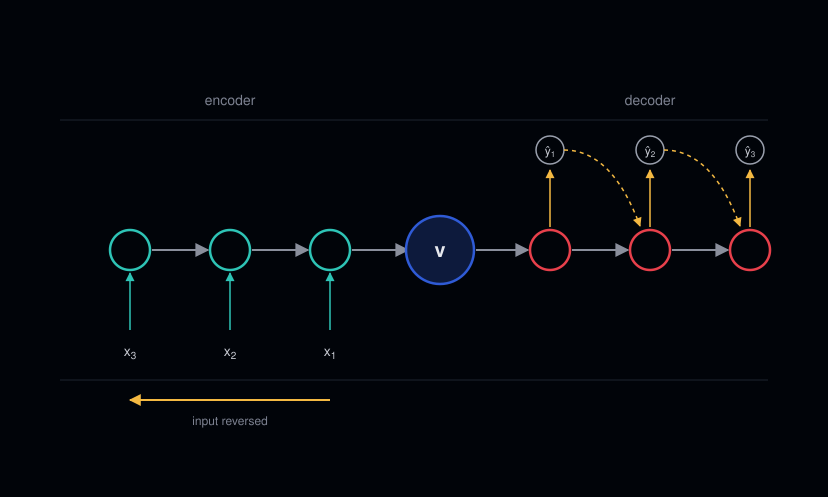

# Sequence to Sequence Learning with Neural Networks

Sutskever, Vinyals & Le, 2014

*Paper:* [PDF on arXiv](https://arxiv.org/pdf/1409.3215)\
*Group Whiteboarding:* [Questions.pdf](questions.pdf)\
[Founders & Coders Workshop](https://www.foundersandcoders.com/workshops/50), 9 September 2026

