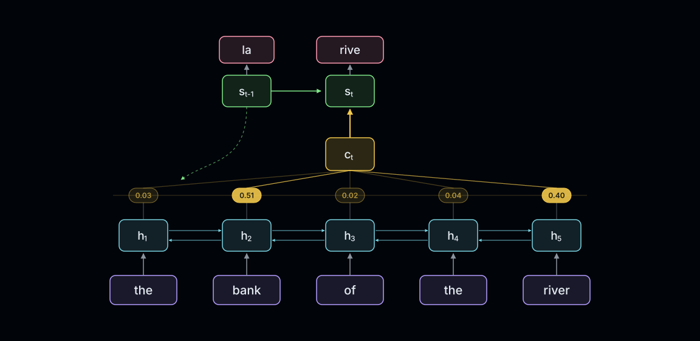

# Neural Machine Translation by Jointly Learning to Align and Translate

Bahdanau, Cho & Bengio, 2015

*Paper:* [PDF on arXiv](https://arxiv.org/pdf/1409.0473)\
[Founders & Coders Workshop](https://www.foundersandcoders.com/workshops/52), 30 September 2026

