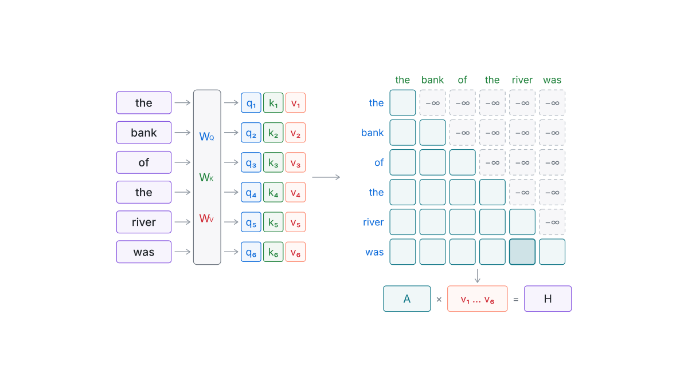

# Improving Language Understanding by Generative Pre-Training

Radford et al., 2018

*Paper:* [PDF from OpenAI](https://cdn.openai.com/research-covers/language-unsupervised/language_understanding_paper.pdf)\
[Founders & Coders Workshop](https://www.foundersandcoders.com/workshops/59), 28 October 2026

<picture>
  <source media="(prefers-color-scheme: dark)" srcset="diagram-dark.svg">
  
</picture>
