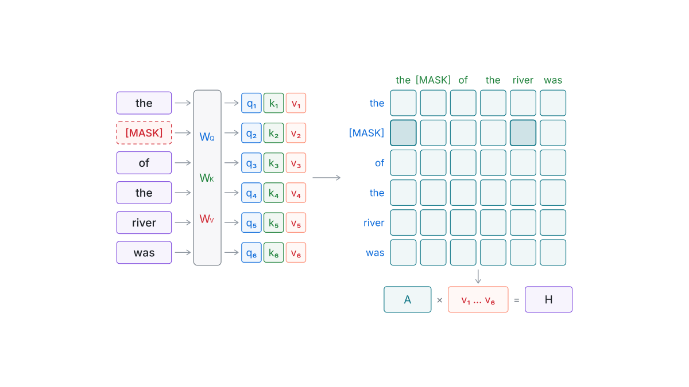

# BERT: Pre-training of Deep Bidirectional Transformers for Language Understanding

Devlin et al., 2018

*Paper:* [PDF on arXiv](https://arxiv.org/pdf/1810.04805)\
*Group Whiteboarding:* [Questions.pdf](questions.pdf)\
[Founders & Coders Workshop](https://www.foundersandcoders.com/workshops/60), 11 November 2026

<picture>
  <source media="(prefers-color-scheme: dark)" srcset="diagram-dark.svg">
  
</picture>
