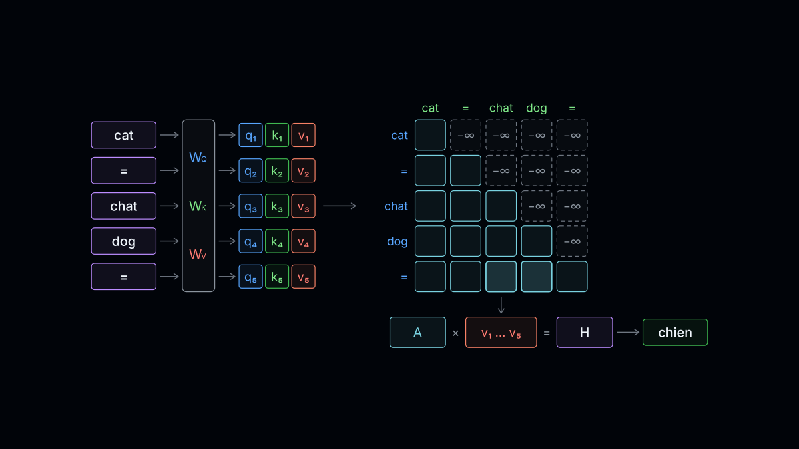

# Language Models are Unsupervised Multitask Learners

Radford et al., 2019 (GPT-2)

*Paper:* [PDF from OpenAI](https://cdn.openai.com/better-language-models/language_models_are_unsupervised_multitask_learners.pdf)\
*Group Whiteboarding:* [Questions.pdf](questions.pdf)\
[Founders & Coders Workshop](https://www.foundersandcoders.com/workshops/63), 25 November 2026

