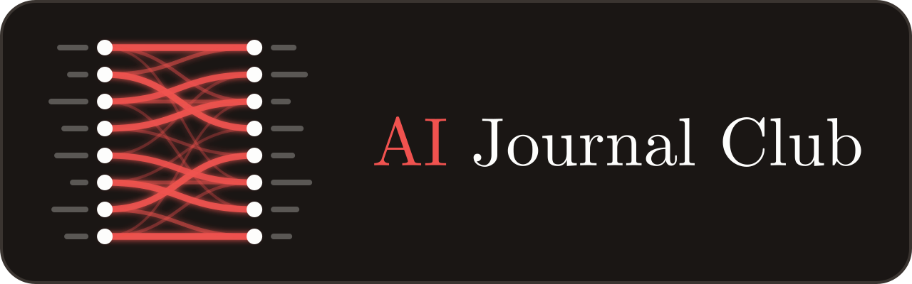

Facilitated by [Founders & Coders](https://www.foundersandcoders.com/workshops). Part of our fortnightly series of paper reading sessions. Check out the journal club channel on our applicant [Discord server](https://discord.gg/y6AXyzbXUX).

**How the session works:** This is not a walkthrough. We'll split into small groups to work through a set of questions, then regroup for answers and an open discussion.

**Who is this for:** Experienced software engineers. You don't need a research background, though you'll get more out of the evening if you're comfortable with the basics of neural networks. You don't need to have come to the earlier sessions.

**What to bring:** The paper, read beforehand. You won't need a laptop.

## 9 September 2026

[Founders & Coders Workshop](https://www.foundersandcoders.com/workshops/50)\
*Paper:* [Sequence to Sequence Learning with Neural Networks](https://arxiv.org/abs/1409.3215)\
*Group Whiteboarding:* [Questions.pdf](2026-09-09-seq2seq/questions.pdf)

## 30 September 2026

[Founders & Coders Workshop](https://www.foundersandcoders.com/workshops/52)\
*Paper:* [Neural Machine Translation by Jointly Learning to Align and Translate](https://arxiv.org/abs/1409.0473)\
*Group Whiteboarding:* [Questions.pdf](2026-09-30-bahdanau/questions.pdf)

## 14 October 2026

[Founders & Coders Workshop](https://www.foundersandcoders.com/workshops/56)\
*Paper:* [Attention Is All You Need](https://arxiv.org/abs/1706.03762)\
*Group Whiteboarding:* [Questions.pdf](2026-10-14-transformer/questions.pdf)

## 28 October 2026

[Founders & Coders Workshop](https://www.foundersandcoders.com/workshops/59)\
*Paper:* [Improving Language Understanding by Generative Pre-Training](https://cdn.openai.com/research-covers/language-unsupervised/language_understanding_paper.pdf)\
*Group Whiteboarding:* [Questions.pdf](2026-10-28-gpt-1/questions.pdf)

## 11 November 2026

[Founders & Coders Workshop](https://www.foundersandcoders.com/workshops/60)\
*Paper:* [BERT: Pre-training of Deep Bidirectional Transformers for Language Understanding](https://arxiv.org/abs/1810.04805)\
*Group Whiteboarding:* [Questions.pdf](2026-11-11-bert/questions.pdf)

## 25 November 2026

[Founders & Coders Workshop](https://www.foundersandcoders.com/workshops/63)\
*Paper:* To be decided
